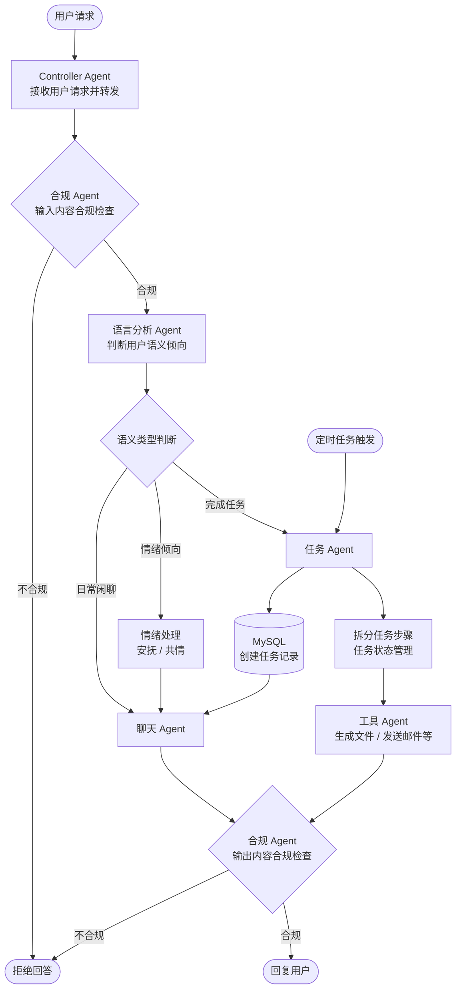

# 系统架构
**架构类型**：动态规划驱动多 Agent 系统
## 整体架构说明
系统采用**中心化调度 + 职能化 Agent 分工**的架构，
以 DP 动态规划调度 Agent 作为全局管控唯一中转节点，
其余 Agent 为专项能力执行节点，所有节点间交互均通过调度 Agent 转发，
实现职责解耦、流程可控与状态统一管理。
## 核心能力
- 日常自然对话交互与共情回应
- 实时细粒度情绪与心理标签提取
- 全量对话与标签数据持久化归档
- 历史对话与人格特征多维度回溯
- RAG 知识库驱动的正向心理建议输出
- 定制化情绪 / 心理分析报告自动生成
- 全链路内容安全与专业合规校验
## 业务流程示例


## 项目目录结构
```
self‑mirror‑agent
├── src/main/java/com/mirror/agent
│   ├── config                    // Spring-AI / Milvus / Redis 配置Bean
│   ├── dp                        // DP调度核心包
│   │   ├── entity                // 任务状态、AgentExecutionPlan、SubTask实体
│   │   └── scheduler             // DpScheduleAgent 调度核心类
│   ├── agent                     // 所有Agent定义
│   │   ├── resident              // 常驻Agent实现
│   │   └── temp                  // 动态临时Agent实现
│   ├── message                   // Agent通信消息POJO
│   ├── tool                      // 工具层全部实现
│   ├── repository                // Mybatis Mapper，Milvus向量库封装
│   ├── entity                    // 数据库实体类
│   ├── service                   // 上层业务服务
│   └── util                      // 通用工具、Markdown报告渲染工具
├── src/main/resources
│   ├── application.yml
│   └── db/migration              // flyway *.sql 迁移脚本
├── docker
│   └── docker‑compose.yml        // 开发环境：mysql8, redis7, milvus
├── pom.xml
└── README.md
```